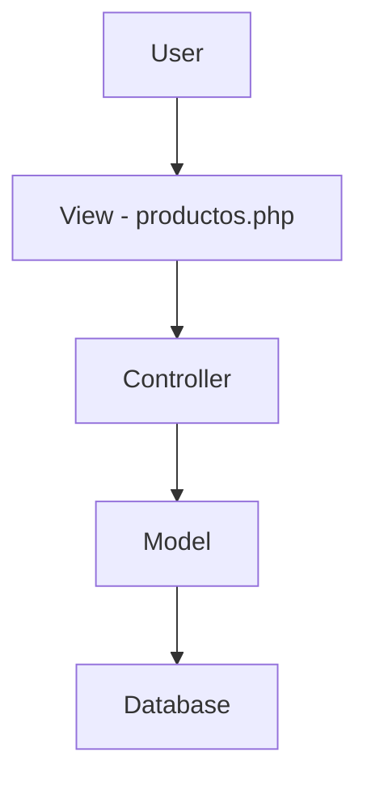

# TechHub Store

## Description

Online store web application built with PHP using the MVC architecture.
Users can sign up, log in, add products to a cart and place orders.

---

## Tech stack

- PHP (OOP)
- MySQL
- HTML5, CSS3
- JavaScript (AJAX)
- XAMPP

---

## Installation

1. Clone the repository or download the project
2. Copy the project folder into `htdocs`
3. Start Apache and MySQL in XAMPP
4. Create a database named `techhub_store`
5. Import the `techhub_store.sql` file
6. Open in your browser:

http://localhost/techhub/public

---

## Features

- User registration
- Login / Logout
- Product listing
- Shopping cart
- Checkout (creates an order in the database)

---

## Architecture (MVC)

- **Models:** data access (User, Product)
- **Views:** user interface (productos.php)
- **Controllers:** application logic (ProductoController)

---

## Database

The system uses a MySQL database named `techhub_store`.

### Main tables

- **usuarios**: registered users (name, email, hashed password).
- **productos**: products available in the store (name, description, price).
- **ordenes**: each purchase made by a user.
- **detalle_orden**: links products to a specific order, including quantity.

### Database script

The `techhub_store.sql` file included in the project contains:

- Creation of all required tables
- Relationships between tables through foreign keys
- Sample data (products)

Import this file in phpMyAdmin for the system to work correctly.

---

## Functions by module

**User**
- Sign up
- Log in
- Log out

**Products**
- List products from the database

**Cart**
- Add product
- Remove product
- Empty cart

**Order**
- Checkout (creates an order and its details in the database)

---

## Author

Miguel Ángel Rios
